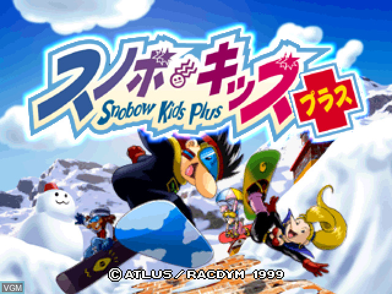

# Snowboard Kids Plus



A matching decompilation of **Snobow Kids Plus (Japan)** for the PlayStation
(`SLPS-01823`).

**An existing copy of the game is required. This repository does not include
game disc data or extracted assembly. This project is not a port to PC
or any other platform: it combines reverse-engineered C with assembly and data
extracted from your copy to produce an identical PlayStation executable.**

The current build covers the boot executable, `SLPS_018.23`. Overlay and asset
data in `SNB/SNB.DAT` is not yet split or rebuilt.

## Cloning

```sh
git clone https://github.com/cdlewis/snowboardkidsplus-decomp.git
cd snowboardkidsplus-decomp
```

## Dependencies

The current build is verified on Linux (x86-64). The GCC binaries require a
kernel capable of running static 32-bit x86 executables.

System packages:

- make
- git
- python3 and venv/pip
- cpp (host C preprocessor)
- binutils-mips-linux-gnu

On Debian/Ubuntu:

```sh
sudo apt install make git python3 python3-venv python3-pip cpp binutils-mips-linux-gnu
```

Install Python dependencies in a virtual environment:

```sh
python3 -m venv .venv
.venv/bin/pip install pycdlib 'splat64[mips]' 'mapfile-parser>=2.13.2,<3'
```

Install the native Linux PSX GCC binaries from
[decompals/old-gcc](https://github.com/decompals/old-gcc/releases/tag/0.17)
under `tools/gcc/`. The current build requires these paths:

```text
tools/gcc/gcc-2.8.1-psx/cc1
tools/gcc/gcc-2.7.2-psx/cc1
```

Game C uses GCC 2.8.1; selected SDK units use GCC 2.7.2.
GCC 2.8.0 is an optional matching candidate at `tools/gcc/gcc-2.8.0-psx/cc1`.
The compiler binaries are ignored by Git;
maspsx is included in the repository.

## Building

Place your MODE2/2352 disc dump at:

```text
Snobow Kids Plus (Japan)/Snobow Kids Plus (Japan).bin
```

Build and verify:

```sh
./tools/build-and-verify.sh
```

The wrapper extracts the boot executable if missing, cleans the build,
regenerates split assembly, checks every source `INCLUDE_ASM`, builds the full
executable, and independently verifies both the original and rebuilt images
against the committed checksum. It then
writes a fresh progress report to `build/report.json`. Any failed step fails
the command.

The supported executable is:

| Version | Extracted filename | SHA1 |
| --- | --- | --- |
| Japan (`SLPS-01823`) | `disc/SLPS_018.23` | `3f1a7abc267ea29bafed1653121613ea467c1ac8` |

A successful build prints `build/slps_018.23.exe: OK` and ends with
`BUILD SUCCEEDED`. Run the wrapper again after changing sources, symbols,
headers, or split configuration.

| Command | Purpose |
| --- | --- |
| `./tools/build-and-verify.sh` | Clean, regenerate, verify the executable, and report progress |
| `./tools/build-and-verify.sh --expected` | Also snapshot verified targets to `expected/` and update `objdiff.json` |
| `./tools/build-and-verify.sh --objects` | Also prepare comparison objects for objdiff after verification |
| `./tools/build-and-verify.sh --objects --non-matching` | Include guarded partial C in the comparison objects |
| `./tools/build-and-verify.sh --jobs 8` | Clean build with eight parallel Make jobs |
| `./tools/build-and-verify.sh --incremental --jobs 8` | Rebuild changed inputs and verify the full executable |

`--expected` and `--objects` can be combined; targets are snapshotted before
comparison objects are compiled. Comparison builds do not establish new matches.

The Makefile owns preprocessing, compilation, assembly, linking, conversion,
and checksum verification. Header and assembler include dependencies are tracked;
unchanged objects are reused with `--incremental`. Compiler settings are declared
in `config/compiler.mk`, including the existing per-function selections.
Comparison objects live in `build/compare/`, separate from the verified image's
objects. Objdiff builds those objects through Make. `tools/build.py` only adapts
isolated matching attempts to the same Make rules and retains the protected
checksum used by validation.

Agents must use the wrapper instead of direct make, splat, build-driver, or
progress-report commands. The Makefile remains an internal build interface.
Codex and Claude hooks enforce this policy. Shared Python guards live in
`tools/agent-hooks/`. They also reject edits to assembly, generated `ctx.c`,
reference `.sha1` files, and the expected SHA1 fields in `tools/build.py`,
`snowboardkidsplus.yaml`, and `decomp.yaml`. Shell writes to those files and
Git hook bypasses (`--no-verify` and `git commit -n`) are blocked; assembly
reads and wrapper regeneration remain available. These guards inspect visible
tool arguments, including literal commands in Codex orchestration calls; they
are mistake guards, not a sandbox for arbitrary programs or dynamic paths.
Run their regression checks with
`python3 -m unittest discover -s tools/agent-hooks -p 'test_*.py'`.

Codex users must review
and trust the project hook using `/hooks` before it runs; see the
[official hook documentation](https://learn.chatgpt.com/docs/hooks).

Progress counts assembly-backed functions as unmatched even when the executable
rebuilds exactly. Data progress is excluded because it has no matching markers.
Each wrapper run clears and regenerates the function disassemblies:
`asm/nonmatchings/` contains assembly fallbacks, and `asm/matchings/` retains
original instructions for matched C functions. Regenerating these files before
reporting prevents stale assembly from undercounting matched C.

## Compiler and assembler settings

The pipeline is host `cpp` → PSX GCC `cc1` → maspsx (ASPSX 2.77 emulation) →
GNU MIPS assembler/linker → objcopy. PS1 code is little endian and has R3000
load and branch delay slots.

The current game compiler is GCC 2.8.1, but the historical compiler version and
game-wide `-G` value remain unconfirmed. Keep all game code on one compiler.
`SKP_CC1` and `SKP_G_VALUE` select the default lane; per-unit settings live in
`config/compiler.mk`. The default is `-G0`; the matched RNG unit has verified local
`-G8` settings. `$gp` is `0x8013AE48`. Pass the same `-G` value to cc1, maspsx,
and GNU as; small-data declarations also affect load-delay scheduling.

Separately linked SDK units may use other vendored compilers. The shared
GCC 2.7.2 profiles in `config/compiler.mk` preserve GNU as `-O2` reorder
scheduling and original section padding. Profiles with `INDEXED` also delegate
symbolic indexed loads to GNU as, allowing its load-destination temporary instead
of ASPSX's `$at`. These compatibility settings do not establish the original
compiler or assembler. Verify the complete affected unit after changing them.

Function-scoped flags or SDK compiler overrides compile the same preprocessed
translation unit and select the complete `.ent`/`.end` region. Preserve its
other functions and data, check local labels, and require the full-image gate;
keep logical modules intact. Section padding can also change data placement:
use separately named data sections and YAML `linker_section` mappings where
needed, checking bytes and addresses together.

The linked SDK is PSY-Q 4.2, identified by `tools/find_psyq.py` using
[psx_psyq_signatures](https://github.com/lab313ru/psx_psyq_signatures). The library
block begins at `0x800A8204`; game code starts at `0x800131B4` and precedes it.
The signature scan bootstrapped the layout; `snowboardkidsplus.yaml` is now the
source of truth for unit boundaries. Its `string_encoding: ASCII` preserves
Japanese string bytes, and `ld_align_section_vram_end: False` preserves
unaligned section boundaries.

## Project structure

| Path | Purpose |
| --- | --- |
| `snowboardkidsplus.yaml` | Splat configuration and executable layout |
| `symbol_addrs.txt` | Known function and data symbols |
| `src/main.c`, `src/main_remaining.c` | Mixed C/assembly game units |
| `src/engine/random.c` | Five matched RNG functions, table, and indices |
| `src/engine/game_task_scheduler.c` | Shared frame-counter storage; scheduler code remains in assembly |
| `src/syslib/` | PSY-Q library units |
| `include/` | Project headers; `common.h` is the master include |
| `tools/build-and-verify.sh` | Supported build, verification, and progress entry point |
| `Makefile`, `config/compiler.mk` | Build rules and verified compiler settings |
| `tools/build.py` | Scratch-build adapter to Make and protected checksum |
| `objdiff.json` | Per-function comparison configuration |

`asm/`, linker scripts and undefined-symbol files in `linkers/`, and `expected/`
are generated. Update the configuration and regenerate them with `./tools/build-and-verify.sh`
or `./tools/build-and-verify.sh --expected` rather than editing them by hand. The per-function
disassembly in `asm/nonmatchings/` is the reference for matching.

## SDK references

The linked SDK is PSY-Q 4.2. Reference SDK code must still match this
executable's instructions, data, and types. Native porting implementations
serve a different purpose from matching SDK sources.

### Local SDK references

Keep reference repositories beside this checkout, outside the project tree.
From this repository's root, create the same local layout with:

```sh
git clone --depth 1 https://github.com/Xeeynamo/psyz.git ../psyz
git clone --depth 1 https://github.com/Xeeynamo/sotn-decomp.git ../sotn-decomp
git clone --depth 1 https://github.com/hansbonini/psx_tomba.git ../psx_tomba
git clone --depth 1 https://github.com/sozud/psy-q-decomp.git ../psy-q-decomp
git clone --depth 1 https://github.com/khasinski/rage-racer-decomp.git ../rage-racer-decomp
```

These are optional source references, not build dependencies. Their paths below
are relative to this repository's root.

| Repository | Local SDK source path | How to use it |
| --- | --- | --- |
| [PsyZ](https://github.com/Xeeynamo/psyz) | `../psyz/decomp/src/` | Matching SDK reference targeting PSY-Q 4.0; use the decompilation tree rather than the native port. Its README documents unresolved compiler/flag differences for 4.1 and later. |
| [Symphony of the Night](https://github.com/Xeeynamo/sotn-decomp) | `../sotn-decomp/src/main/psxsdk/` | Additional C bodies, including `libc/memmove.c` and `libetc/intr_dma.c`. Check SDK headers under `../sotn-decomp/include/` and each source file's license notice. |
| [Tomba](https://github.com/hansbonini/psx_tomba) | `../psx_tomba/src/psyq/` | Broad controller and sound references. Its README describes mixed SDK versions, including libpad 4.2; its Makefile has GNU-as scheduling settings for controller units and counters. |
| [Sozud's psy-q-decomp](https://github.com/sozud/psy-q-decomp) | `../psy-q-decomp/src/` | Original-object matching reference targeting PSY-Q 3.5; useful for comparing older implementations and toolchain behavior. |
| [Rage Racer](https://github.com/khasinski/rage-racer-decomp) | `../rage-racer-decomp/src/main/PAL/lib/` | Additional implementation references. Some solutions use fixed registers or inline assembly and cannot be adopted under this project's C matching rules. |

Search several implementations before choosing a source shape, for example:

```sh
rg -n '\bmemmove\b' ../psyz/decomp/src ../sotn-decomp/src/main/psxsdk ../psx_tomba/src/psyq ../psy-q-decomp/src ../rage-racer-decomp/src/main/PAL/lib
rg -n 'GNU_AS_UNITS|LIBPAD 4\.2' ../psx_tomba/Makefile
git -C ../sotn-decomp rev-parse HEAD
```

Preserve applicable license notices when using reference code. Reference
matches depend on their SDK version and build settings; verify this game's
types, data layouts, instructions, and full executable before integrating C.

## Matching tools

After a verified build, create a function workspace:

```sh
./tools/codex --bootstrap-only FUNCTION
```

Enter the printed directory under `nonmatchings/` and run `./build.sh base.c`
and `./diff.sh`. The workspace includes original target assembly and a verified
target object, preprocessed source context, and an existing C attempt or m2c
output when available. Install `m2c` separately if you want automatic initial C
for functions without an existing attempt. Add `--id ID` to reuse a workspace
without overwriting source. Omit `--bootstrap-only` to launch Codex there.
Each build retains its comparison artifacts under `attempts/` and uses the
owning unit's compiler settings. Exact scratch results still require integration
and full executable verification.

[DECOMPILATION_LEARNINGS.md](DECOMPILATION_LEARNINGS.md) collects PSX matching
techniques.
[AGENTS.md](AGENTS.md) indexes four repo-local skills for function matching,
data matching, symbol renaming, and optional permuter experiments.

After `./tools/build-and-verify.sh`, rank live game functions and find structural references:

```sh
python3 tools/score_functions.py --limit 20
python3 tools/find_similar_functions.py func_8008C670 --top 10
```

SDK functions are excluded by default; add `--sdk` to include them. Ranking
uses a transparent complexity heuristic; similarity compares normalized MIPS
instructions. Neither score proves a match. Discovery follows active source
includes, so stale local assembly files do not become candidates.

Keep a single-function attempt in ignored `nonmatchings/`, including real
project headers and declaring referenced data `extern`. With a fresh green
build, compile and compare it without changing live build/expected objects:

```sh
./tools/build-and-verify.sh
python3 tools/match_function.py FUNCTION nonmatchings/FUNCTION/attempt.c
```

The helper inherits the owning unit's compiler and flags; use
`--unit src/path.c` if ownership is ambiguous. It writes linked byte checks,
disassembly, a diff, and provenance in `result.json` under the scratch folder.
`EXACT` requires equal bytes, size, and address. Integrate the C and run the
normal full build afterward. Owned data and jump tables require full-TU
objdiff instead of this single-body helper.

Verify a data symbol's address and bytes, or locate a full-image difference:

```sh
python3 tools/data_diff.py gRandomTable
python3 tools/data_diff.py SYMBOL --size 0x100
python3 tools/data_diff.py --find-first-mismatch
```

Data checks derive PSX load addresses from the executable header and read
little-endian ELF symbols. They reject stale builds and non-file-backed BSS.
An explicit size can fill missing symbol metadata. Comparisons return 0 for
an exact match, 1 for a mismatch, and 2 for unsupported or missing input.
`./tools/build-and-verify.sh` remains the full-image gate.

These tools use only the Python standard library and the existing compiler
pipeline.

Partial implementations use `#ifdef NON_MATCHING` with the original assembly
in the default branch. Their comments record the best observed instruction
similarity from `tools/match_function.py`: its ordered matching four-byte words
divided by the larger instruction-stream length, including any padding in the
target extent. This is a reproducible search aid, not objdiff's percentage or
proof of correctness. Only a byte-exact comparison and the full executable gate
establish a match. Normal and expected-object builds do not enable the define.
Comparison-only settings may select a different SDK compiler for a partial
function; they do not change the compiler or bytes used by the normal build.

## Commit validation

Install the tracked Git hook once per clone:

```sh
./tools/install-git-hooks.sh
```

The hook rejects changes to the expected SHA1 in the build script and YAML
metadata and runs the same clean build-and-verify workflow, including fresh
splits, live include checks, independent image verification, and progress reporting.
A commit proceeds only when the image matches
`disc/SLPS_018.23` byte for byte. It also independently hashes both files
against the committed checksum. It does not refresh `expected/` or stage files.

Stage all changed build inputs before committing. The hook rejects unstaged or
untracked files under `src/`, `include/`, and `tools/`, plus unstaged root symbol,
relocation, and build configuration files, so validation covers what will actually be committed.
Unrelated notes and local files such as `.envrc` can remain unstaged. Generated
assembly, linker outputs, and build/expected objects must remain unstaged.
If `core.hooksPath` already points elsewhere, the installer leaves it intact;
chain `tools/git-hooks/pre-commit` from that hook setup.

## Contributing

Contributions are welcome! Useful areas include:

- Match functions and keep the full executable byte-identical.
- Investigate and document function names, data structures, and game behavior.
- Identify the original compiler settings and remaining SDK code.
- Document disc assets and overlays beyond the boot executable.
- Improve setup instructions and test builds on other platforms.

Use the extracted disassembly as the reference for contributions. Contributions
must not be based on leaked source code or proprietary knowledge about the game.

## Acknowledgements

Thanks to the developers of [splat](https://github.com/ethteck/splat),
[maspsx](https://github.com/mkst/maspsx),
[old-gcc](https://github.com/decompals/old-gcc),
[objdiff](https://github.com/encounter/objdiff), and
[psyz](https://github.com/Xeeynamo/psyz).
